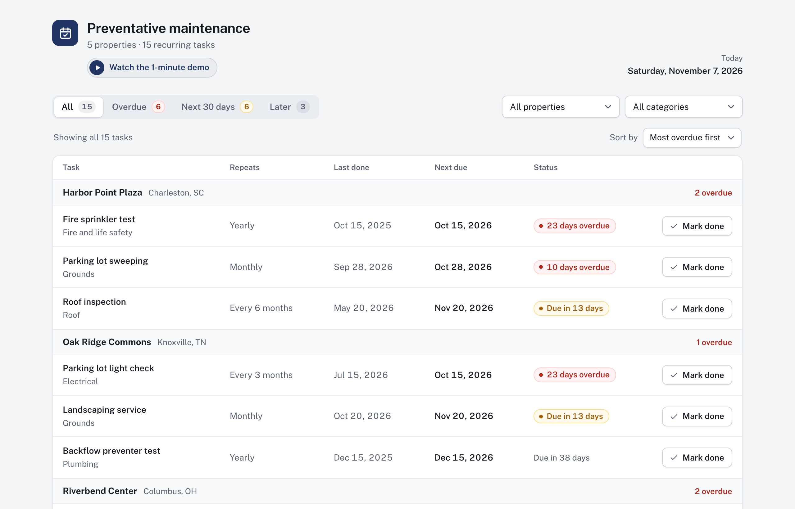

# Preventative Maintenance Calendar

A small React and TypeScript app that shows property managers which recurring maintenance is coming due at each property, and what is already late.

**Running copy:** https://maintenance-calendar-nine.vercel.app

**Demo video (1 minute, narrated, with captions):** https://maintenance-calendar-nine.vercel.app/#demo, or the **Watch the 1-minute demo** button under the page title. It loads only when opened, so it costs the page nothing.



## Run it

You need Node.js 20.19+ or 22.12+.

```bash
npm install
npm run dev
```

Then open http://localhost:5173.

| Command         | What it does                                              |
| --------------- | --------------------------------------------------------- |
| `npm test`      | Runs the tests                                            |
| `npm run check` | Type check, lint, format check and tests                  |
| `npm run build` | Production build in `dist/` (`npm run preview` serves it) |

To see the schedule as it will look on another day, add `?today=` to the address, for example http://localhost:5173/?today=2027-01-31.

## What it does

- Lists every maintenance item under its property: how often it repeats, when it was last done and when it's next due.
- Flags overdue items in red. An item is overdue once its next due date has passed, so an item due today isn't overdue yet.
- **Mark done** sets the item's last completed date to today, which moves its next due date forward. A message confirms the new date and offers Undo; it stays until it's closed, so nobody has to race a timer. Changes last until the page is refreshed, as the brief allows.
- Filters by property and by category.
- Sorts most overdue first: each property's items, and the properties themselves by their most overdue item. **Sort by** can switch the properties to A to Z.
- Works from the keyboard: after Mark done, focus moves to Undo, and Undo or Escape puts it back on the task.

## My addition: a 30-day look-ahead

Overdue tells a manager what has already been missed. Most of this work needs a vendor booked ahead (an elevator inspection or a sprinkler test can't be arranged the day it's due), so the app also flags in amber everything due in the next 30 days. The counts at the top (Overdue, Next 30 days, Later) work as filters, so the routine is: clear the overdue list, then book the next 30 days.

It's one rule in `src/lib/schedule.ts`: an item is overdue when its due date has passed, due soon when it's 0 to `DUE_SOON_DAYS` (30) days away, and later after that.

## How it works

- **Reading the data** (`src/data/portfolio.ts`). Vite bundles the two CSV files as text, PapaParse splits them into rows, and each row is checked and turned into a typed record. A row that can't be trusted, such as a date of 2026-02-30, a frequency of "quarterly" (or more than 120 months) or an unknown property, is skipped and listed at the top of the page, so nothing is guessed and the rest still loads.
- **Working out due dates** (`src/lib/dates.ts`, `src/lib/schedule.ts`). Next due is last completed plus the frequency in months. Dates stay plain `YYYY-MM-DD` calendar days, and the month arithmetic works on the year, month and day numbers, so a day that doesn't exist becomes the last day of the month (January 31 plus one month is February 28) and no time zone can move a date. Four of the fifteen sample items land on a short month; August 31 plus six months, for example, is February 28, 2027.
- **Marking an item done** (`src/useMaintenance.ts`). The only thing that changes is that item's last completed date. The next due date, status and counts are worked out from it on every render, so they can't fall out of step. Undo puts the previous date back. A task already done today can't be marked again, so its date never moves backwards.

Assumptions: "today" is the date on the viewer's device, checked again whenever the tab comes back into view, so a page left open overnight moves on to the new day. A task marked done early or late starts its next cycle from the day it's marked done, as the brief's rule says.

## Not done, and what I'd build next

Everything in the brief is done. Next, in order:

1. **Save completions.** Marking done resets on refresh. Against a real API, Mark done would send the completion and the page would reload the item from the server.
2. **Record the actual completion date.** A manager who logs a vendor's visit a few days late would want to enter the day the work was done, so the next due date doesn't drift later every cycle. That matters most for yearly fire and life safety checks.
3. **A look-ahead per category.** An elevator inspection may need 60 days' notice; landscaping needs none.
4. **A completion history**: who did it, when, which vendor, what it cost.

## Project layout

```text
src/
  App.tsx               the page: header, filters, table, undo message
  useMaintenance.ts     the items in memory, Mark done and Undo
  useToday.ts           today's date, checked again when the tab comes back
  data/portfolio.ts     reads and checks the CSV files
  lib/dates.ts          calendar date arithmetic
  lib/schedule.ts       next due date and status
  lib/filters.ts        filters, counts and grouping by property
  lib/format.ts         dates and labels for display
  components/           the toolbar, the table, the undo message and the demo video
```

The tests sit next to the code (`*.test.ts`). They check every sample item's due date against values worked out by hand, the month-end and leap-year cases, the CSV checks, and the whole Mark done, Undo, filter and sort flow in the page, keyboard focus included. The page tests use a small data set of their own (`src/test/fixtures.ts`), so editing the sample CSV files or the 30-day setting doesn't break them. They run on US Eastern time, where the properties are, so a date that slips to the day before in the US fails them.

---

Written for Ziff Real Estate Partners as a paid test project. The code belongs to Ziff.
